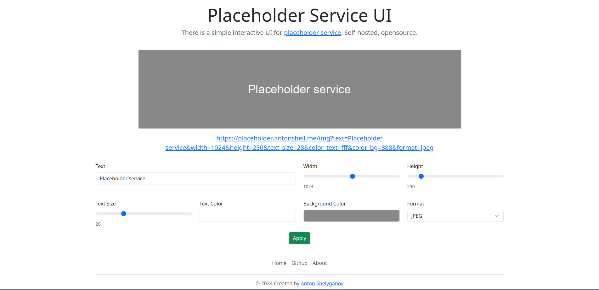

# Placeholder service UI

There is a simple UI for simple self-hosted [placeholder service](https://github.com/antonshell/placeholder-service).



Demo: [https://placeholder-ui.antonshell.me/](https://placeholder-ui.antonshell.me/)

Project created with:
- [Angular](https://github.com/angular/angular) version 17.0.8 
- [Node.js](https://nodejs.org/) version 20
- [Bootstrap](https://getbootstrap.com/) version 5

# Install

1 . Clone repository

```
git clone git@github.com:antonshell/placeholder-service-ui.git
```

2 . Run containers

```
docker compose up -d
```

The local stack uses the `dev` target of the same `Dockerfile` as production (Node.js 20 + Chromium for tests)
and runs `ng serve`. Containers run as your host user (`HOST_UID`/`HOST_GID`, default `1000`),
so generated files belong to you.

3 . Install dependencies (then restart the container: `docker compose restart app`)

```
docker compose run --rm app npm ci
```

4 . Open app

[http://localhost:4200/](http://localhost:4200/)

Without docker: `npm ci && npm start` (Node.js 20).

# Deploy (production)

Every route (`/`, `/about`) is prerendered at build time, so production needs no Node.js server:
the image is [Caddy](https://caddyserver.com) serving `public/browser/` as static files,
behind the existing Caddy container (`/srv/proxy`).

Every push to `main` runs `.github/workflows/ci.yml`: audit, tests and the image build run in parallel.
The build job smoke-tests the image and pushes it to `ghcr.io/antonshell/placeholder-service-ui` only if it passes;
the deploy job restarts the stack on the server via SSH only when tests and build are green.
The audit job (`npm audit`) is informational: findings show up as warnings and never block deploy.
The 10 most recent images are kept in GHCR as rollback targets.

## One-time server setup

Server layout: Caddy lives in `/srv/proxy` (compose + Caddyfile) and is attached to the external docker network `web`.
The app stack lives in `/srv/placeholder-service-ui`.

1 . Create a deploy user with docker access (if it doesn't exist yet) and a directory for the stack

```
sudo useradd --create-home --shell /bin/bash --groups docker deployment && sudo usermod --password '*' deployment
sudo mkdir -p /srv/placeholder-service-ui && sudo chown deployment:deployment /srv/placeholder-service-ui
```

Add the public part of the deploy SSH key to `/home/deployment/.ssh/authorized_keys`.

2 . Add the site to `/srv/proxy/Caddyfile` (see `deploy/Caddyfile.example`) and reload Caddy

```
placeholder-ui.antonshell.me {
	encode zstd gzip
	reverse_proxy placeholder-service-ui:8080
}
```

```
cd /srv/proxy && docker compose exec caddy caddy reload --config /etc/caddy/Caddyfile
```

## GitHub configuration

Settings → Environments → `production` → secrets:

| Secret           | Example                          |
|------------------|----------------------------------|
| `DEPLOY_HOST`    | server IP / hostname             |
| `DEPLOY_PORT`    | `22` (optional)                  |
| `DEPLOY_USER`    | `deployment`                     |
| `DEPLOY_SSH_KEY` | private key (ed25519)            |
| `DEPLOY_PATH`    | `/srv/placeholder-service-ui`    |

## Build the production image locally

```
docker build -t placeholder-service-ui .
docker run --rm -p 8080:8080 placeholder-service-ui
```

## Smoke test of the production image

`.github/scripts/smoke-test.sh` starts the image with a read-only file system (as in `deploy/compose.yml`) and checks:

- the container becomes `healthy`; `/` and `/about` return `200` with prerendered content and `Cache-Control: no-cache`;
  an unknown route returns `404`
- the hashed bundles referenced by the page are served with `Cache-Control: public, max-age=31536000, immutable`
- `/favicon.ico` is served and cached
- the SSR server bundle and build metadata are not in the image

It runs in CI before the image is pushed to GHCR; to run it locally:

```
docker build --target prod -t placeholder-service-ui:prod .
.github/scripts/smoke-test.sh placeholder-service-ui:prod
```

The container is published on `127.0.0.1:18099` (override with `SMOKE_PORT=...`) and removed afterwards;
on failure the script prints the failed checks and the container logs and exits with code `1`.

# Tests

Unit tests (Karma, headless Chromium) with coverage:

```
docker compose exec app npx ng test --no-watch --no-progress --code-coverage
```

The HTML report is in `coverage/src/index.html`. In CI the coverage table is in the job summary,
the full report in the **coverage** artifact of the run; at least 95% coverage is required.

# Code generation

```
ng generate service services/auth
ng generate guard guards/auth
ng generate component components/tag-edit
```
